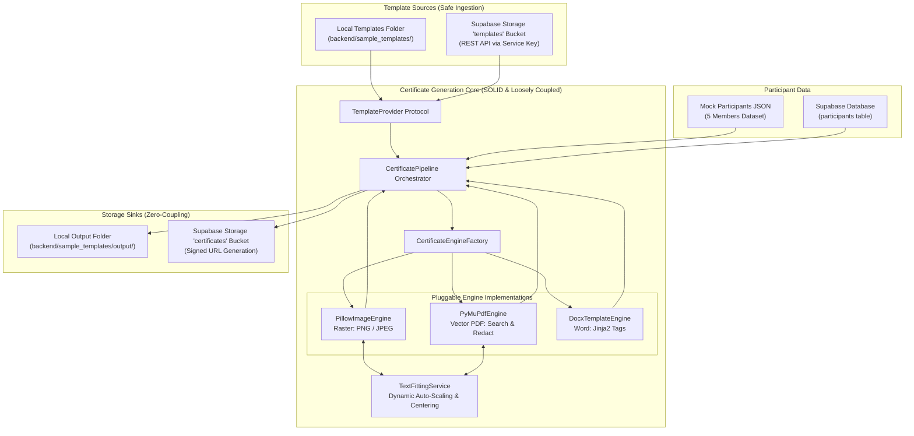
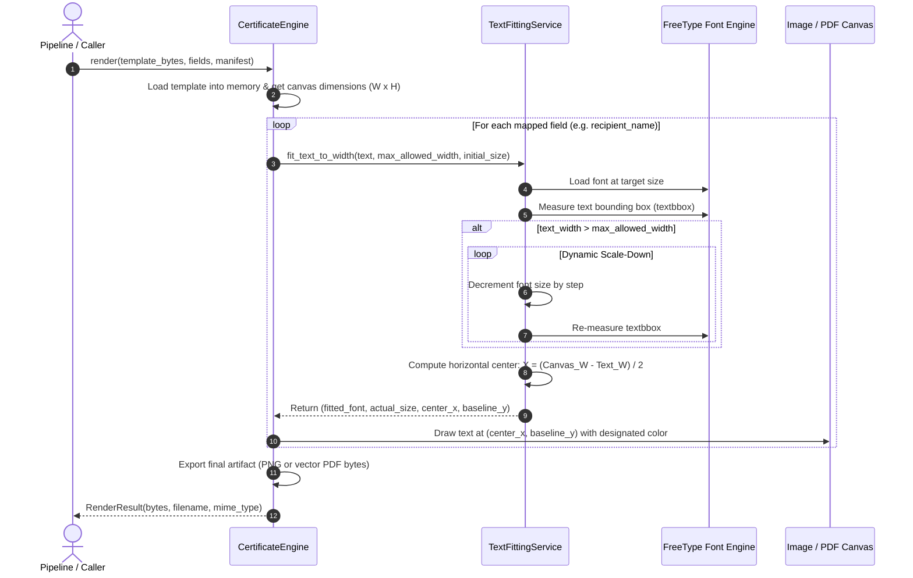
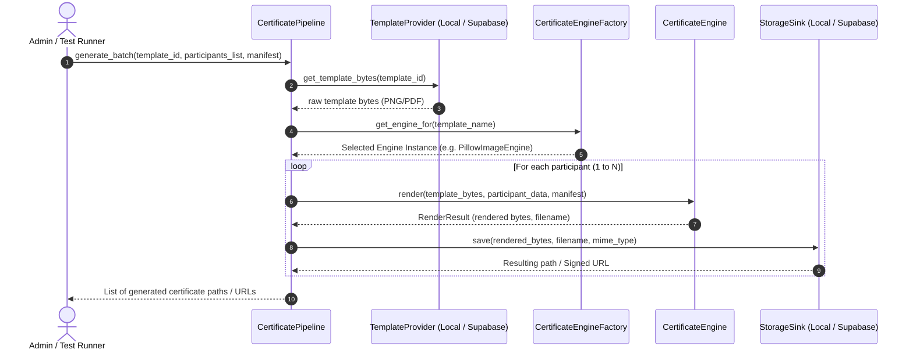

# Certificate Generation Engine Architecture & Design Specification

This document details the modular, loosely-coupled architecture for the **Autocert Certificate Generation Engine**. It is designed following **SOLID principles** using Python `typing.Protocol` interfaces, Dependency Injection, and the Factory Pattern.

---

## 1. High-Level System Architecture

The certificate engine operates as an independent, self-contained core processing unit that accepts template assets and participant records, calculates dynamic spatial layouts, renders personalized certificates, and delivers the results to local disk or Supabase Storage.

---

## 2. SOLID Architecture Class Diagram

All modules interact exclusively through abstract protocols (`typing.Protocol`), satisfying the **Dependency Inversion** and **Interface Segregation** principles.

```mermaid
classDiagram
    direction TB

    class TemplateProvider {
        <<Protocol>>
        +get_template_bytes(template_id: str) bytes
        +get_template_name(template_id: str) str
    }

    class LocalTemplateProvider {
        -str base_dir
        +get_template_bytes(template_id: str) bytes
        +get_template_name(template_id: str) str
    }

    class SupabaseTemplateProvider {
        -str supabase_url
        -str service_key
        -str bucket_name
        +get_template_bytes(template_id: str) bytes
        +get_template_name(template_id: str) str
    }

    TemplateProvider <|.. LocalTemplateProvider
    TemplateProvider <|.. SupabaseTemplateProvider

    class CertificateEngine {
        <<Protocol>>
        +can_handle(file_extension: str) bool
        +render(template_bytes: bytes, fields: dict, manifest: TemplateManifest) RenderResult
    }

    class PillowImageEngine {
        -TextFittingService text_service
        +can_handle(file_extension: str) bool
        +render(template_bytes: bytes, fields: dict, manifest: TemplateManifest) RenderResult
    }

    class PyMuPdfEngine {
        -TextFittingService text_service
        +can_handle(file_extension: str) bool
        +render(template_bytes: bytes, fields: dict, manifest: TemplateManifest) RenderResult
    }

    class DocxTemplateEngine {
        +can_handle(file_extension: str) bool
        +render(template_bytes: bytes, fields: dict, manifest: TemplateManifest) RenderResult
    }

    CertificateEngine <|.. PillowImageEngine
    CertificateEngine <|.. PyMuPdfEngine
    CertificateEngine <|.. DocxTemplateEngine

    class TextFittingService {
        +measure_text(text: str, font) tuple
        +fit_text_to_width(text: str, font_family: str, target_size: int, max_width: int) tuple
        +wrap_text(text: str, font, max_width: int) list
        +calculate_center_x(total_width: int, text_width: int) int
    }

    PillowImageEngine --> TextFittingService
    PyMuPdfEngine --> TextFittingService

    class StorageSink {
        <<Protocol>>
        +save(file_bytes: bytes, filename: str, mime_type: str) str
    }

    class LocalDiskSink {
        -str output_dir
        +save(file_bytes: bytes, filename: str, mime_type: str) str
    }

    class SupabaseStorageSink {
        -str supabase_url
        -str service_key
        -str bucket_name
        +save(file_bytes: bytes, filename: str, mime_type: str) str
    }

    StorageSink <|.. LocalDiskSink
    StorageSink <|.. SupabaseStorageSink

    class CertificatePipeline {
        -TemplateProvider template_provider
        -CertificateEngine engine
        -StorageSink storage_sink
        +generate_one(template_id: str, participant: dict, manifest: TemplateManifest) str
        +generate_batch(template_id: str, participants: list, manifest: TemplateManifest) list
    }

    CertificatePipeline o-- TemplateProvider
    CertificatePipeline o-- CertificateEngine
    CertificatePipeline o-- StorageSink
```

---

## 3. Dynamic Text Mapping & Anti-Collision Flow (No Random X/Y)

To guarantee that recipient names never collide with borders, underlines, or seals regardless of their length, the engine executes dynamic auto-scaling and alignment calculation:

### 3.1 Dynamic Resolution & Aspect-Ratio Independence

The certificate automation module operates with **zero fixed dimensions**:
- **Arbitrary Template Sizes**: Whether a template is uploaded as 720p (1280x720), 1080p (1920x1080), 2000x1414, 4K UHD (3840x2160), or A4 / Letter 300+ DPI print resolution, the layout engine adjusts automatically.
- **Proportional Metrics**: All layout coordinates (`x_pct`, `y_pct`), bounding box constraints (`max_w_pct`), target font sizes (`font_size_pct`), and minimum scaling limits (`min_font_size_pct`) are defined strictly as relative ratios (0.0 to 1.0) of the actual template's dimensions.
- **Adaptive Step Sizing**: Font auto-fitting employs adaptive step calculations (`max(1, int(target_size * 0.025))`) rather than static pixel decrements, preventing performance degradation on high-DPI templates while maintaining typography precision.
- **Defensive Area Clearing**: Dynamic masks (`clear_area` percentages) allow automated clearing of pre-existing placeholder slots on templates of any dimension.

---

## 4. End-to-End Batch Generation Flow

---

## 5. UI Libraries for Certificate Generation (Categorized by Module)

When integrating the frontend dashboard, the system is separated into decoupled modules:

| Module | Purpose | Recommended UI Libraries | Architectural Role |
|---|---|---|---|
| **1. Template Canvas Designer & Field Mapper** | Visual drag-and-drop editor where admins place placeholders (`{{name}}`, `{{date}}`) on an uploaded template. | **Konva.js / React-Konva** *(Alternative: Fabric.js)* | **React-Konva** offers a clean React component hierarchy over HTML5 Canvas, layer isolation (template background vs draggable text fields), boundary snapping, and direct serialization to normalized coordinate JSON. |
| **2. PDF High-Fidelity Viewer & Overlay** | In-browser vector PDF preview with interactive SVG/HTML overlay fields. | **PDF.js (Mozilla)** / **react-pdf** | Vector rendering in canvas without rasterization loss, matching backend PDF point coordinates (72 DPI). |
| **3. Turnkey Canvas Design Studio** | Full Canva-style embedded design tool. | **Polotno Studio SDK** | Complete turnkey canvas editor component for certificates, badges, and banners. |
| **4. Participant Data Mapping & Grid** | Data import table for mapping Excel/CSV/JSON columns to certificate placeholders. | **TanStack Table (React Table)** | High-performance virtualized grid handling 10k+ rows with inline validation. |
| **5. Certificate Approval & Preview Carousel** | Modal viewer for inspecting generated sample certificates (first 5, random 5) before sending. | **Embla Carousel** / **Swiper.js** + **React-PDF-Viewer** | Smooth touch/mouse pagination with zoom, pan, and full-screen inspection. |

---

## 6. Execution Modes (Dual Workflow)

### Mode 1: Local Folder-In / Folder-Out
- **Template Input**: `backend/sample_templates/Black Gold Formal Appreciation Certificate.png` (or `.pdf`)
- **Output Destination**: `backend/sample_templates/output/`
- **Use Case**: Rapid local development, unit testing, and instant visual verification without needing cloud credentials.

### Mode 2: Supabase Cloud Storage
- **Template Input**: Supabase Storage `templates` bucket.
- **Output Destination**: Supabase Storage `certificates` bucket.
- **Use Case**: Production pipeline, signed URL delivery, and distributed cloud workers.
